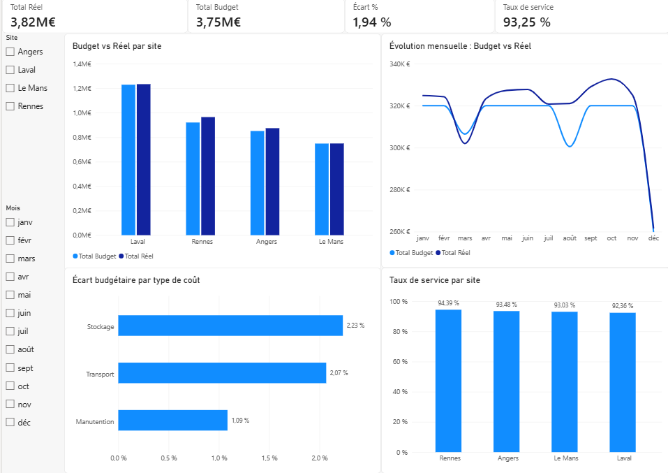
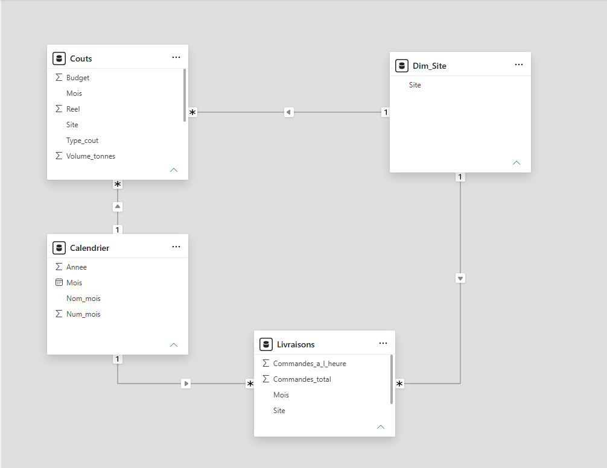

# Tableau de bord Supply Chain – Power BI

Tableau de bord de **contrôle de gestion logistique** réalisé avec **Python, Power Query et Power BI**.
Il consolide automatiquement les fichiers de coûts de plusieurs sites, fiabilise les données, puis suit les indicateurs clés : **budget vs réel, écarts et taux de service**.

>  Les données sont **entièrement fictives**, générées par un script Python, pour une entreprise imaginaire (« LaitNord », 4 sites logistiques).



---

##  Contexte

Chaque mois, chaque site logistique envoie au siège un fichier Excel contenant ses coûts (transport, stockage, manutention) et ses livraisons.
Sans outil, le contrôleur de gestion doit ouvrir les fichiers un par un, les copier-coller dans un fichier global et vérifier les erreurs à la main.

**Objectif du projet :** automatiser cette consolidation, améliorer la qualité des données et fournir un tableau de bord de pilotage.

---

##  Étapes du projet

### 1. Génération des données (Python)
Le script `generer_donnees.py` (pandas) crée un fichier Excel par site (Laval, Rennes, Le Mans, Angers), avec deux feuilles :
- **Couts** : site, mois, type de coût, budget, réel, volume en tonnes ;
- **Livraisons** : site, mois, commandes totales, commandes livrées à l'heure.

Des **erreurs volontaires** sont ajoutées pour simuler des données réelles : valeurs manquantes, nom de site mal saisi, lignes en double.

### 2. Consolidation automatique (Power Query)
- Connexion à un **dossier** : tous les fichiers des sites sont combinés automatiquement en une seule table.
- Un nouveau site ou un nouveau mois ? Il suffit de déposer le fichier dans le dossier et d'**actualiser**.

### 3. Qualité des données (Power Query)
| Problème détecté | Correction appliquée |
|---|---|
| Nom de site mal saisi (« angers ») | Mise en majuscule de la 1re lettre |
| Lignes en double | Suppression des doublons |
| Coûts réels manquants | Exclusion de la ligne complète (budget et réel) |
| Dates lues comme des nombres | Conversion au type Date |

Ces étapes sont enregistrées et **rejouées automatiquement** à chaque actualisation.

### 4. Modèle de données (schéma en étoile)
- **Tables de faits** : `Couts`, `Livraisons`
- **Tables de dimension** : `Dim_Site`, `Calendrier` (créées en DAX)
- Relations **un-à-plusieurs** : un même filtre (site, mois) agit sur l'ensemble du rapport.



### 5. Indicateurs (mesures DAX)
| Mesure | Formule |
|---|---|
| Total Budget | `SUM(Couts[Budget])` |
| Total Réel | `SUM(Couts[Reel])` |
| Écart | `[Total Réel] - [Total Budget]` |
| Écart % | `DIVIDE([Écart], [Total Budget])` |
| Taux de service | `DIVIDE(SUM(Livraisons[Commandes_a_l_heure]), SUM(Livraisons[Commandes_total]))` |

Les résultats ont été **vérifiés** en recalculant les indicateurs de manière indépendante en Python.

### 6. Tableau de bord
- 4 cartes KPI : total réel, total budget, écart %, taux de service
- Filtres : site et mois
- Budget vs Réel par site
- Évolution mensuelle Budget vs Réel
- Écart budgétaire par type de coût
- Taux de service par site

---

##  Principaux enseignements

- Sur l'année, les sites ont dépensé **3,82 M€** pour un budget de **3,75 M€**, soit un dépassement de **+1,94 %**.
- **Rennes** est le site qui dépasse le plus son budget (**+4,79 %**), mais c'est aussi celui qui a le meilleur **taux de service** (**94,4 %**).
- **Laval** et **Le Mans** respectent presque leur budget (+0,38 % et +0,10 %).
- Taux de service global : **93,25 %**.

---

##  Limites et qualité des données

Quatre coûts réels étaient manquants dans les fichiers sources (Angers en mars, Laval en août, Rennes et Le Mans en décembre).
Les lignes concernées ont été **exclues en entier**, pour ne pas fausser l'écart budgétaire. Si l'on avait gardé le budget sans le réel, le tableau de bord aurait affiché de fausses économies.

Conséquence visible : la courbe du budget baisse sur ces mois-là, notamment en décembre.
Dans un contexte réel, ces anomalies seraient **signalées aux sites** afin d'obtenir les données manquantes.

---

##  Contenu du dépôt

```
├── README.md
├── generer_donnees.py            # génération des fichiers des sites
├── donnees_sites/                # fichiers Excel des 4 sites (données fictives)
├── dashboard_supply_chain.pbix   # rapport Power BI
└── captures/                     # captures d'écran du tableau de bord
```

##  Reproduire le projet

1. Installer les bibliothèques : `pip install pandas openpyxl`
2. Lancer le script : `python generer_donnees.py`
3. Ouvrir `dashboard_supply_chain.pbix` dans **Power BI Desktop**, puis modifier le chemin du dossier source (Transformer les données → Paramètres de la source de données) et **actualiser**.

---

## Outils

Python (pandas) · Power Query · Power BI · DAX · Modélisation en étoile

##  Auteur

**M'hand Amrane** – Étudiant en Master Data Engineering, Université de Corse
[GitHub](https://github.com/MhandAMRANE)
